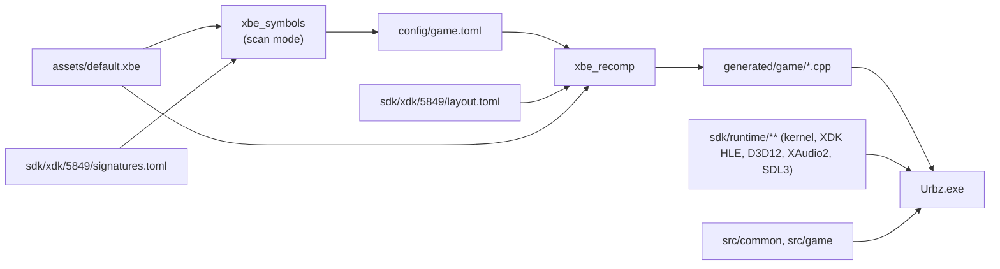

# XboxXBERecomp SDK - workflow and contract

SDK checkout: `sdk/`, commit `65e959d4a5fd0c171dc7b17f3f9b44bab00928e6` (2026-10-11), `SDK_VERSION` 0.1.0, MIT.
Every claim below cites a path and line inside `sdk/`.

## Pipeline



## Tools

| Tool | Source | Built by | Role |
| --- | --- | --- | --- |
| `xbe_symbols` | `sdk/tools/symbols/main.cpp` (1365 lines) | CMake target `xbe_symbols` | Matches XDK library code inside the XBE against the signature set and writes `config/game.toml`; `--sign` also produces new signature sets |
| `xbe_recomp` | `sdk/tools/recomp/main.cpp` (245 lines) + `analysis.cpp`, `codegen*.cpp` | CMake target `xbe_recomp` | x86 -> C++ recompiler: discovers functions, resolves switch tables, emits the partitioned sources |

### `xbe_symbols`

Usage, verbatim (`sdk/tools/symbols/main.cpp:1358-1363`):

```
usage: xbe_symbols <game.xbe> <sdk>/xdk [--out config/game.toml] [--name game]
       xbe_symbols --sign <config.toml>... --out signatures.toml [--skip name,...]
```

- `--name` sets `out = "generated/<name>"` in the written config; it defaults to `game` (`main.cpp:1364`).
- Empty `--out` prints the config to stdout (`main.cpp:1328`).
- The XDK build is taken from the XBE's library-version records (XBE header `0x160` count, `0x164` address;
  `sdk/runtime/xbe/xbe.h:126-134`). Priority is the `D3D8`, then `D3D8LTCG`, then `XAPILIB` build, then any
  other library's build (`main.cpp:952-959`); the first of those with an existing
  `xdk/<build>/signatures.toml` wins (`main.cpp:963-967`).
- If no shipped build matches, it prints `no signatures for these library builds; available:` with the
  builds it does have and exits 1 **without writing a config** (`main.cpp:969-974`, `1298-1299`).
  Producing a new set then needs `xdk/<build>/layout.toml` plus `xbe_symbols --sign` over games whose
  configs are already complete.
- Report lines it prints: `found %zu of %zu functions, %zu of %zu data` (`main.cpp:1244-1245`) and
  `missing (0, the host traps if the game calls one):` (`main.cpp:1248`). A name left at `0` becomes a
  trapping stub, not a silent no-op.

### `xbe_recomp`

Usage, verbatim (`sdk/tools/recomp/main.cpp:204`):

```
usage: xbe_recomp <config.toml> [xbe override] [out override] [--xdk <SDK xdk folder>]
```

It refuses to run against a different image than the config was written for:
`... was written for title %08X entry %08X, not this image: delete it so build.bat writes a new one`
(`main.cpp:234`). Generated files land in `[xbe] out` (`generated/game/` here):
`image_symbols.h`, `x86_recomp_shared.h`, `x86_recomp.<p>.cpp` (one per partition),
`x86_func_mapping.cpp`, `x86_recomp_stats.txt` (`sdk/tools/recomp/codegen_emit.cpp:227-289`).
Functions absent from the image get `x86_trap(ctx, …, "not in this image")` bodies
(`codegen_emit.cpp:259-284`).

## CMake

`add_xbe_image(target xbe config partitions game_dir)` - five positional arguments
(`sdk/cmake/XbeRecomp.cmake:54`):

| Arg | Meaning |
| --- | --- |
| `target` | name of the WIN32 executable (`XbeRecomp.cmake:81`) |
| `xbe` | XBE file name under `assets/` (`:67`, `:76`) |
| `config` | config file name under `config/` (`:65`) |
| `partitions` | number of `x86_recomp.<i>.cpp` sources generated (`:57-60`) |
| `game_dir` | output dir `generated/<game_dir>` and per-image hook glob `src/<game_dir>/*.cpp` (`:55`, `:74`) |

The game's CMakeLists must set `XBE_HOST_SOURCES` before calling it (`XbeRecomp.cmake:52`), provide
`assets/<xbe>`, and a config whose `out` matches `generated/<game_dir>` (`:53`). Configure time also emits
`<target>_xbe.cpp` holding the XBE's SHA-1 as `kImageSha1` (`:78-80`), so a swapped disc image is detected.

This repository calls `add_xbe_image(Urbz default.xbe game.toml ${GAME_PARTITIONS} game)`
(`CMakeLists.txt:37`), with `GAME_PARTITIONS` read back out of `config/game.toml`.

## `config/game.toml`

Written by `xbe_symbols`, then corrected by hand. Keys read by the recompiler
(`sdk/tools/recomp/main.cpp:32-168`):

| Key | Type | Purpose |
| --- | --- | --- |
| `includes` | string[] | merge other config files, resolved relative to the includer (`:75-79`) |
| `[xbe] path` / `out` | string | image to read, directory to generate into (`:80`, `:85`) |
| `[xbe] title` / `entry` | int | guard against recompiling a different image (`:81-82`, `:233-237`) |
| `[xbe] xdk` | int | includes `<xdk>/<build>/layout.toml` (`:64-70`) |
| `[xbe] partitions` | int | number of generated translation units (`:86`) |
| `[xbe] code_sections` / `code_prefixes` | string[] | which XBE sections are code (`:89-94`) |
| `[xbe] data_ranges` | [int,int][] | byte ranges inside code sections that are never code, end exclusive (`:95-99`) |
| `[xbe] gap_fill`, `pointer_seeds` | bool | function discovery strategies (`:87-88`) |
| `[xbe] trace` | int[] | log each call of these functions and its `eax` (`:83-84`) |
| `[functions]` | addr -> name | extra entry points the analysis missed (`:100-101`) |
| `[symbols]` / `[data]` | name -> addr | XDK functions and data the host replaces; `0` = trapping stub (`:102-104`) |
| `[layout]` | name -> int | XDK structure offsets, normally merged from `xdk/<build>/layout.toml` (`:105-107`) |
| `[abi]` | name -> loc[] | argument registers for link-time-code-generated libraries (`:108-127`) |
| `[[function]]` | `at`, optional `end` | force an entry point / stop decoding (`:145-151`) |
| `[[switch]]` | `at`, `targets[]` | override indirect-jump table detection (`:152-163`) |
| `[[hook]]` | `at`, `call`, `after`, `on_true`, `on_false` | call a game function before/after a guest instruction; with `on_true`/`on_false` the hook returns `bool` and may `"ret"` or jump to another instruction of the same function (`:132-144`) |

Bad entries abort: `bad [[hook]] entry` (`:128-131`), `[[function]] %08X: not decodable code or end not above it`
(`:176`), `[[switch]] %08X: not a decoded indirect jmp` (`:182`).

## Host-side contract

`app::GameInfo` (`sdk/runtime/app/app.h:72-93`) is the only mandatory game-provided symbol
(`extern const GameInfo kGame;`, `app.h:94`); this repo defines it in `src/common/game_info.cpp`.
18 fields: `title`, `short_title`, `name`, `log`, `settings`, `splash`, `missing`, `images`, `options`,
then the optional callbacks `load`, `save`, `init`, `loaded`, `window`, `message`, `ui`, `pad`, `rumble`.
`images` is the xbe-name -> exe-name table used when the game launches another title
(`sdk/runtime/kernel/boot.cpp:157-164`).

Overrides and hooks live in `src/game/` (excluded from the host source glob, `CMakeLists.txt:23-24`):

```cpp
X86_EXTERN_FUNC(__imp__sub_00012345);     // the recompiled original
X86_FUNC(sub_00012345) {                  // strong definition wins over the generated weak one
    __imp__sub_00012345(ctx, base);
}
```

`X86_FUNC` / `X86_EXTERN_FUNC` / `X86_WEAK_FUNC` are defined at `sdk/runtime/cpu/x86_ops.h:24-27`;
both take `(X86Context& ctx, uint8_t* base)`. `X86Context` holds the eight 32-bit GPRs, the flag
fields and `fs_base` (`sdk/runtime/cpu/x86_context.h:11-16`). `[[hook]]` callbacks declared in
`config/game.toml` are forward-declared into `x86_recomp_shared.h` by the recompiler
(`codegen_emit.cpp:233-235`).

## Build

`CMakePresets.json` (copied from the SDK template): generator Ninja, `CMAKE_C_COMPILER=clang`,
`CMAKE_CXX_COMPILER=clang++`, `-march=x86-64-v2`, binary dir `out/build/<preset>`, presets
`debug` / `release` / `relwithdebinfo`, Windows-gated. Zydis, toml++, Dear ImGui and SDL3 are fetched
by CMake. `build.bat` drives the whole sequence: configure `release`, build `xbe_symbols`, write
`config/game.toml` if it has no `[symbols]` yet, then build the executable.

## What is never committed

`sdk/templates/game/.gitignore` (adopted here) ignores `/out/`, `/build/`, `/generated/`, `/assets/`,
`settings.toml`, `/logs/`, `/hdd/`, `/CrashDumps/` and build artefacts. `config/game.toml` **is**
tracked: it is addresses and names, not game code. This repo additionally ignores `*.iso` and
`/.toolchain/`.
